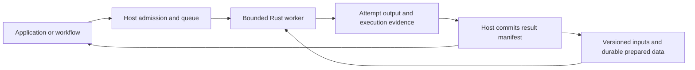

<!-- SPDX-License-Identifier: Apache-2.0 -->

# Portable serverless execution with durable preparation

Status: accepted November 8 maintainer queue addition, following the active
item-19 rich-data lifecycle work. This document queues implementation and
acceptance; it establishes no deployed worker, remote service or performance
result. The [phase plan](phased-execution-plan.md) remains the execution order.

Use short-lived Rust workers around the existing native engine, with useful
prepared data, source metadata and execution evidence surviving worker loss.
Serverless is a deployment mode, not a fourth engine alongside the batch/live/
hybrid modes in [RFC 0034](../rfcs/0034-three-engine-certified-data-execution-fabric.md).
The portable worker and artifact foundations precede the first host adapter.
Attach the Foundry adapter to [item 21's existing owner](native-foundry-integration-2026-10-25.md),
then complete the policy/measurement and selective-access stages below before
the subsequent AI-data package. Preserve the existing Foundry batch, multi-file
and managed-table deliverables; this addition does not replace them.

The November 8 maintainer clarification keeps native packages in ordinary
single-node Foundry transforms as the primary Foundry integration. Compute
Modules are an optional request-serving adapter, neither the only route nor
the preferred host. Package imports, dataset/Iceberg access, native execution
and committed output must remain usable without a Compute Module or a running
ShardLoom REST service.

The current implementation program remains RFC 0044. Workflow, remote API,
packaging, commit/recovery and I/O obligations remain with RFCs 0033/0035/0036,
0024/0017/0031 and their existing owners. CG-1 through CG-23 retain independent
acceptance. No new phase or competitive-gate identifier is introduced.

## Starting point and limits

At intake, main is `9c4ada03e1c30ed20fd2118c78a8be3fb69b0dd8`, the merge of
[vector-expression PR #1671](https://github.com/depsilon/shardloom/pull/1671).
The [provider update](native-provider-upgrade-2026-11-08.md) supplies Vortex
0.93.0 and Arrow/Parquet 59.3.2. Pin the eventual worker's complete runtime,
provider, feature, artifact-format and package identities; this intake is not
a promise that every future version can read every retained artifact.

- The actual [remote capability implementation](../../shardloom-core/src/remote_api.rs)
  reports HTTP listening and remote execution as unsupported. Discovery and
  probes are not a running query service. The first delivery needs a real
  worker adapter, with capability reporting changed only for proved behavior.
- [Object-store smoke code](../../shardloom-cli/src/object_store_runtime.rs)
  uses local-emulator paths or caller-supplied local fixture bytes. Recognizing
  an S3/GCS/ADLS URI does not establish a live network reader. Start with
  authorized files staged by the host; record staging cost and bytes.
- Existing [rich-column fidelity](../reference/rich-columns.md) and
  [managed-binary persistence](native-managed-binary-objects-2026-11-06.md)
  provide scoped fresh-process readback foundations. External references keep
  their external ownership; a portable result must preserve all required bytes
  or report its explicit dependency. Exact vector functions add a candidate
  workload, not ANN or sparse/quantized arithmetic acceptance.
- [Adaptive ownership acceptance](native-adaptive-acceptance-2026-11-02.md)
  covers local source, conversion, operator, spill, delivery, writer and queue
  owners. PulseWeave/Capillary do not become fleet autoscalers or distributed
  query schedulers through this deployment wrapper. Native credits are not a
  whole-container RSS ceiling.
- The accepted historical 10,000-case total remains **1,513.095098453 engine
  seconds**. [PR #1657's combined candidate](../benchmarks/native-selection-retention-2026-11-04.md)
  passed correctness but regressed and was restored. No individual component
  was accepted from its setup improvement. Its two-request
  [construction profile](native-selection-retention-2026-11-04.md) motivates
  inspecting compilation/declaration work, not a general Rust speedup claim or
  a new measurement of current main.
- The [finite Flight fragment-transport candidate](native-exchange-decision-2026-10-21.md)
  was removed after failed benefit gates. Serverless does not revive it or
  authorize an unchanged rerun. Use existing admitted local/native boundaries
  first; any different transport needs its own prospective proof.

## Responsibility and execution contract

The host owns admission to the fleet, queuing, placement, scoped credentials,
replica lifecycle and the durable publication decision. The Rust worker owns
native binding, execution, local memory/CPU admission, spill, cancellation and
attempt-local cleanup inside its declared allocation. Scale independent
requests first. Distributing one query remains separate work involving
partitioning, transport, shuffle, retries and ownership.

A versioned job carries SQL or an admitted portable typed declaration, exact
input identities/schema/interpretation, CPU/memory/scratch/deadline/output
limits, requested output representation, request identity and attempt identity.
Use references to scoped authorization supplied by the host; secrets do not
belong in persisted declarations or evidence. Unsupported plans fail through
the ordinary deterministic native diagnostics. Explain/discovery stays
side-effect-free; preparation, execution and publication are explicit actions.

SQL and DataFrame semantics remain shared with the local engine. Vortex stays
the highest-fidelity native persistence option; requested compatibility outputs
must honor their admitted fidelity contracts. No Spark, DataFusion, DuckDB,
Polars, Velox or source-system pushdown executes unsupported ShardLoom work.
Foundry hosting is distinct from external query-engine execution.

## Five ordered deliveries

| Delivery | Concrete result | Acceptance required before promotion |
| --- | --- | --- |
| 1. Native worker | Headless Rust entry point for one bounded versioned job over authorized local files, ordinary native sessions/plans and explicit output. | Same complete values/types/errors as local SQL/typed declarations; actual limits, deadline/cancellation, denied allocation, child cleanup and complete execution/no-fallback evidence. No public HTTP service is required for this externally scheduled boundary. |
| 2. Durable preparation and results | Versioned artifact manifests, compatibility validation, isolated attempt outputs and committed result handles. | Fresh-process reuse after the producer disappears; stale/changed/missing/incompatible/unauthorized artifact rejection; retries and competing attempts cannot publish duplicate or partial visible results; retained owners protect shared artifacts. |
| 3. One real serverless host | Portable container/package plus an adapter for one explicitly selected managed job or request host. Foundry integration stays package/transform-first; Compute Modules have no preferred-host status. | Actual deployment, authorized input access, native execution, independent output readback, cancellation, failed publication and worker replacement in the target environment. A local simulation or container build does not pass the live-host gate. |
| 4. Execution policies and routing evidence | Explicit cold/scale-to-zero, warm-pool and data-local policies; direct-source versus prepared-data routing with explainable evidence. | Frozen equivalent requests across cold, warm, reused, invalidated and concurrent states; complete correctness, latency, resources, bytes and observed host cost. Keep deployment gains and engine changes independently attributable. |
| 5. Selective access and preparation | A real remote reader and, where evidence justifies it, reusable preparation of selected partitions/columns. | Authorized range reads and source-generation checks; less transferred data/repeated work on the selected workload; failure/retry/resource/fidelity proof. Remote commits and partial preparation are new adapter capabilities, not inferred from URI parsing or local smoke results. |

Before each delivery, freeze the smallest missing wire/identity/publication
contract, finite acceptance cases and resource limits. Reuse existing native
owners and validators. Do not impose a separate framework or duplicate Foundry
and generic implementations of the same worker semantics.

## Durable identity, reuse and publication

Reusable identity binds the source snapshot/object generation, schema and
interpretation settings, preparation recipe/representation/version, compatible
runtime/provider requirements and authorization context where it affects
access or results. Validate integrity and compatibility on opening; a pathname,
matching schema label or prior successful run is insufficient. Recreate
process-local sessions/plans rather than serializing pointers or leases.

Keep source manifests/schema, validated statistics, prepared native data,
portable declarations and completed result artifacts distinct. Each needs its
own freshness, invalidation, retention and authorization rules. Expiring or
replacing a worker must not expire a committed artifact that still has owners.
Warm caches are optional and disposable; durable identities are authoritative.

The [existing v1 source-reuse contract](v1-source-prepared-state-scope.md) executes
each query and forbids answer caching. Reading the committed outcome of the
same request for idempotent retry must be distinguished from a new query.
Cross-request completed-result reuse is an explicit later part of delivery 2:
specify eligible deterministic/effect-free declarations, parameters, semantic
settings, source freshness, authorization and invalidation, then update the
versioned contract and tests before enabling it. No hidden global answer cache
is enabled by this intake.

Use the lifecycle: admit snapshot and allocation → identify attempt → execute
into isolated output → validate complete output/evidence → host commits a
durable result manifest. The manifest identifies schema, row count, complete
artifacts and evidence; large results return a handle and small inline results
obey explicit limits. Host commit fencing/idempotency must distinguish completed
computation from visible publication and prevent a late attempt replacing the
winner. Retries may repeat computation; do not claim exactly-once execution.

Checkpoint completed preparation/output stages. A retry can reuse a committed
stage and execute the failed stage again. Suspending and restoring arbitrary
live joins, spill state or sessions remains outside this first durability
contract. Failed attempts reclaim only their uncommitted namespace, never
another request's committed data or externally owned objects.

## Direct execution and virtual preparation

Keep three explicit routes: read the source directly; reuse compatible prepared
native data; or prepare selected useful portions for future requests. The last
route is proposed work. Source registration alone performs no conversion.
Ordinary queries must not require a full dataset ingest or an implicit cache.

Choose preparation only when expected reuse savings justify preparation,
storage/retention and extra movement costs under the declared policy. Include
source selectivity and locality, expose uncertainty and explain the selected
route. Preserve the option to read directly when expected reuse is unknown or
preparation is uneconomic. A route policy is not permission to skip source,
authorization, complete-result or fidelity validation.

## Foundry routes and first-host selection

Keep deployment choice separate from the shared engine, dataset adapters and
durable artifact contracts:

| Route | Role in the integration | Independent acceptance boundary |
| --- | --- | --- |
| Installed native package in single-node Python transforms | Primary Foundry path: ordinary SQL/DataFrame calls over declared inputs and outputs, including the existing dataset and managed-Iceberg deliverables. | Installed native extension, real build/transaction/readback, resource limits and no-fallback proof. No daemon, Compute Module or serverless wrapper is required to call the package. |
| BYOC transform | Alternative packaging when the native runtime or system libraries require a controlled container. | Image/provenance, actual transform behavior and the same data/publication checks; containerization does not change query semantics. |
| External native worker with authorized Foundry API/SDK access | Separate orchestration route when compute lives outside Foundry or a portable job host fits the workload. | Scoped authentication, actual data access/export permissions, source identity, platform publication and cleanup. Do not label externally hosted execution as a Foundry-hosted transform. |
| Compute Module adapter | Optional serving route for workloads that need its request/replica model. | Its actual job protocol, access, concurrency, cancellation, resource and publication behavior. It does not gate the other routes or establish general REST support. |

Palantir documents [single-node transforms](https://www.palantir.com/docs/foundry/transforms-python/transforms)
and [BYOC transforms](https://www.palantir.com/docs/foundry/transforms-python/bring-container)
independently of Compute Modules. The [platform API](https://www.palantir.com/docs/foundry/api/general/overview/introduction)
is a candidate for the external orchestration adapter; verify each needed
endpoint, authorization and data-transfer contract before implementation.
These platform interfaces are source grounding, not ShardLoom deployment proof.

Select the first serverless host from the workload, available access, installed
runtime compatibility, job lifecycle and durable storage/publication contract.
Compute Modules receive no default preference. The first Foundry integration
remains the installed-package transform, and its three batch deliverables
remain required. Do not infer request-serving, warm-pool or scale-to-zero
support from a successful transform build; measure only policies supported by
the selected host and identify any additional host needed to compare them.

A bounded externally scheduled worker may precede a complete `shardloom serve`
REST service. This updates the older blanket REST prerequisite only for that
scoped worker boundary. Existing API/security, governance, package and native
execution evidence still applies. Any optional Compute Module job adapter must
prove its own protocol; a full REST surface keeps its separate CG-23 gates.
Neither one host nor one adapter closes CG-23 or admits general remote execution.

If Compute Modules are selected later, Palantir's documented
[custom-client protocol](https://www.palantir.com/docs/foundry/compute-modules/advanced-custom-client)
is a possible Rust integration seam, not an implemented adapter. Documented
[scaling](https://www.palantir.com/docs/foundry/compute-modules/scaling) permits
zero minimum replicas; [usage](https://www.palantir.com/docs/foundry/compute-modules/usage)
accrues for starting/running replicas. Verify those policies in the actual
environment and keep transport outside the engine.

[Virtual tables](https://www.palantir.com/docs/foundry/data-integration/virtual-tables)
can access supported external tables without first copying them into a Foundry
dataset, but do not inherit dataset versioning/branching. This informs source
registration; it does not prove a ShardLoom adapter or authorize compute
pushdown. No DevCon demonstration implementation or latency claim is adopted.

## Measurement, verification and remaining boundaries

The maintainer explicitly requests separate serverless measurements for queue
delay, worker startup, discovery/staging, preparation/artifact open, binding/
planning, engine execution, encoding/publication and complete-request latency,
plus CPU, peak memory, transferred bytes and billed resource usage. Define
clock boundaries and overlap; use monotonic local durations and do not add
overlapping stages or assume synchronized host clocks. Obtain billed usage
from actual host evidence and leave unavailable values unavailable.

Freeze cold, warm, prepared-reuse, invalidation and concurrent-request cohorts
with equivalent data/results, resources, artifacts, runtime/provider versions
and access policy. Report latency distributions and failure/cancellation rates
for deployment claims. Increased request concurrency may reduce suite elapsed
time without lowering total engine seconds; keep those outcomes distinct.
Routine ShardLoom timing remains engine-only, and the original 10,000-case
engine baseline remains unchanged. This queue addition runs no benchmark.

Adversarial acceptance includes malformed jobs, changed sources, revoked
access, corrupted artifacts, denied resources, expired deadlines, duplicate
delivery, competing/late attempts, worker loss before/after commit, partial
output, failed cleanup and last-owner release. Resource/provider and semantic
proof gaps must remain visible. Actual host access is required for live-host
acceptance; do not replace it with a simulation or weaken the gate.

Package publication, production deployment, unrestricted network access and
new dependencies follow their existing explicit authorization/provenance
rules. Distributed single-query execution, durable continuous processing,
arbitrary live-state checkpointing and ANN remain separate capabilities. The
intended product outcome is one familiar flow: register data, submit a native
query, inspect its chosen route and retain useful committed work after the
worker disappears.
